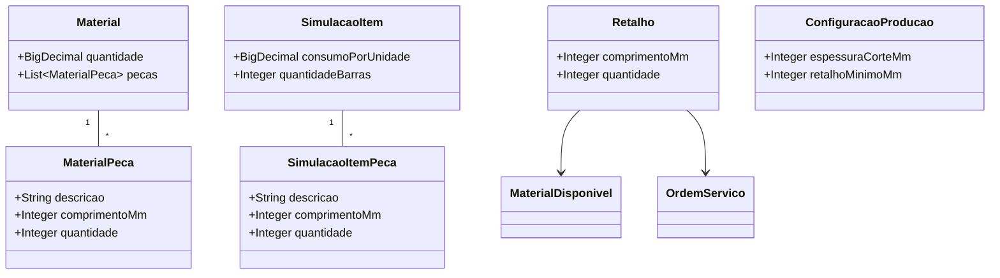
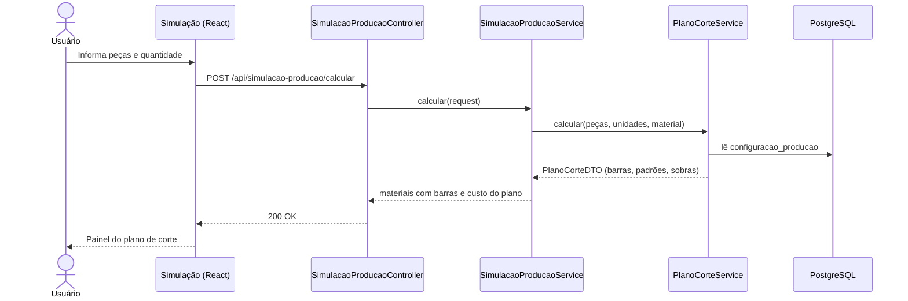
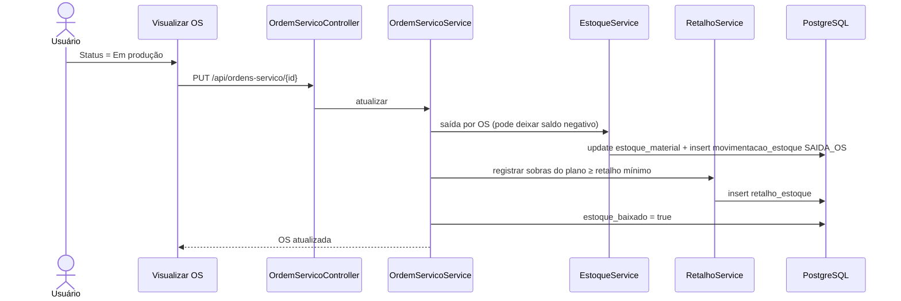
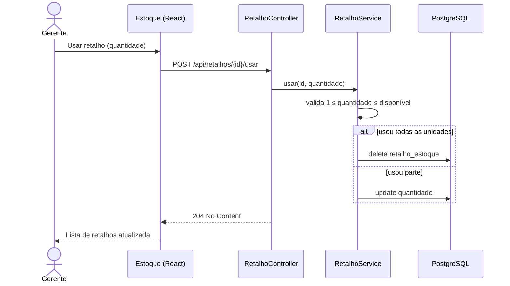
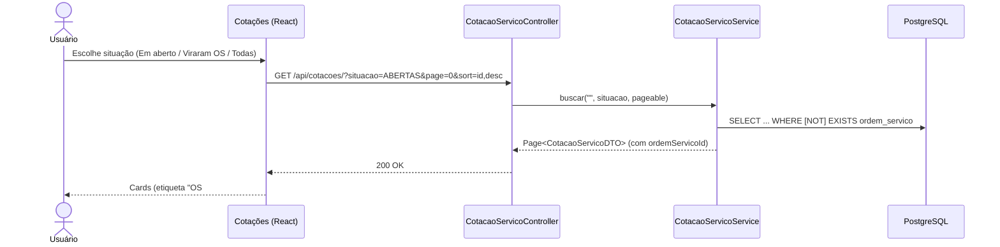

# HSA Serralheria – Atualização da Documentação do TCC
## PARTE 6 – Revarredura de 29/10/2026 e roteiro para montar o PDF

**Situação:** este arquivo é a referência mais recente. Onde as Partes 1 a 5 discordarem dele, vale a Parte 6.
**Base de comparação:** `PARTE5_Revarredura.md` (27/09/2026) e o volume `HSA_Serralheria_Volume_Atualizado.pdf`.

---

## 0. Roteiro para montar o PDF (ordem sugerida)

1. Capa e resumo: colar Resumo/Abstract da seção 4.1.
2. Capítulos 2.4.2, 3.1, 3.2, 3.3, 4.2: colar os textos da seção 4.
3. Capítulo 5 (UML): refazer as figuras listadas na seção 6, usando os esboços Mermaid desta parte.
4. Capítulo 6 (dados): texto da seção 4.7, DER novo (Figura 20) e os dicionários da seção 5, na ordem da seção 5.6.
5. Capítulo 8.1: matriz de acesso da seção 4.8.
6. Capítulo 9: conclusão da seção 4.9.
7. Prints: refazer os da seção 7 (o visual do sistema mudou).
8. Revisar a checklist da seção 8 antes de exportar.

---

## 1. O que mudou no sistema desde 27/09/2026

| Área | Antes (Parte 5 / volume) | Agora |
|------|--------------------------|-------|
| Plano de corte | Removido (não existia mais lista de corte) | **Voltou, de outra forma.** Na Simulação, cada material pode receber as **peças de corte** (descrição, comprimento em mm, quantidade por unidade). O sistema calcula o **plano de corte** (algoritmo *Best Fit Decreasing*): quantas barras comprar, como cortar cada barra, aproveitamento (%) e sucata |
| Quantidade de barras | Estimada por **percentual de perda** | Com peças informadas, a quantidade de barras vem do **plano de corte** (a perda percentual continua valendo para materiais sem peças) |
| Peças na cotação e na OS | — | As peças da simulação seguem para a **cotação** (tabela `material_peca`) e aparecem na **OS** com o plano de corte de cada material |
| Retalhos | Removidos | **Voltaram** (tabela `retalho_estoque`). Ao a OS entrar **Em produção**, as sobras do plano com tamanho ≥ ao mínimo configurado viram retalhos no estoque. Sobras menores contam como sucata |
| Uso de retalho | — | Tela **Estoque → Retalhos disponíveis → Usar retalho**: dá baixa de parte ou de todas as unidades de um retalho |
| Cancelar OS | Devolvia o estoque (opcional) | Além de devolver o estoque, **remove os retalhos gerados por aquela OS** |
| Saldo de estoque | Nunca ficava negativo (travava em zero) | **Pode ficar negativo.** A tela mostra a etiqueta “Faltam X”, indicando o que precisa ser comprado; a devolução ao cancelar a OS volta ao saldo exato |
| Configurações | Abas Usuários e Permissões, WhatsApp | + aba **Produção**: espessura do corte (disco/serra, em mm) e tamanho mínimo para guardar retalho (em cm na tela, gravado em mm) |
| Lista de cotações | Mostrava todas | Cotações que **viraram OS ficam ocultas** (não são apagadas). Filtro **Situação**: Em aberto (padrão), Viraram OS, Todas. O card mostra a etiqueta “OS #n” e o botão “Ver OS” |
| Estado / Cidade | Telas de cadastro no menu | **Ocultos**: saíram do menu e da Home. As tabelas continuam no banco (`pessoa.id_cidade`), mas não fazem parte do escopo apresentado |
| Distribuidora | Excluía direto | Pede **confirmação** antes de excluir |
| Visual | Telas com estilos diferentes | **Padrão único** em todas as telas: fundo cinza-claro, cabeçalho com título e subtítulo, painéis brancos, botões e tabelas na cor #1a1a2e. Cotações continua em **cards**; as demais listas continuam em **tabela** |
| Valores em R$ | Algumas telas mostravam `R$ 0.00` | Formato brasileiro em todo o sistema (`R$ 1.234,56`) |
| Testes automatizados | Nenhum | `PlanoCorteCalculatorTest` (JUnit) cobre o cálculo do plano de corte |

---

## 2. Números atualizados (Caps. 3.3, 4.2 e 9)

| Item | Parte 5 | Agora |
|------|---------|-------|
| Controllers | 26 | **28** (+ `RetalhoController`, `ConfiguracaoProducaoController`) |
| Services | 36 | **40** (+ `PlanoCorteCalculator`, `PlanoCorteService`, `RetalhoService`, `ConfiguracaoProducaoService`) |
| Repositories | 29 | **31** |
| Pacote entity | 40 (30 entidades + 10 enums) | **45 (34 entidades + 11 enums)** |
| DTOs | 44 | **48** |
| Páginas React (pastas) | 20 | **20** (Estado e Cidade existem, mas estão ocultas; no texto, citar **18 telas em uso**) |
| Services frontend | 19 + BaseService | **21 + BaseService** |
| Testes unitários | 0 | **1 classe** (plano de corte) |

Entidades novas: `Retalho` (tabela `retalho_estoque`), `MaterialPeca`, `SimulacaoItemPeca`, `ConfiguracaoProducao`. Enum novo: `SituacaoCotacao` (ABERTAS, COM_OS, TODAS – usado só como filtro da API, não é coluna).

---

## 3. Estado e Cidade – como tratar no TCC

Decisão: **não apresentar** Estado e Cidade.

| Onde aparece hoje | O que fazer |
|-------------------|-------------|
| Diagrama de classes (Figura 3) | Remover as classes `Estado` e `Cidade` e as associações `Pessoa → Cidade → Estado` |
| Diagrama arquitetural (Figura 21) / componentes (Figura 19) | Remover os componentes `[Estado]` e `[Cidade]` |
| DER (Figura 20) | Remover as tabelas `estado` e `cidade` |
| Tabela 1 (Identificação das classes) | Remover a linha “Estado / Cidade – Localização” |
| Dicionário da Pessoa | Omitir a coluna `id_cidade` (ou descrevê-la como “campo legado, não utilizado pelas telas”) |
| Listas de tabelas/ilustrações | Remover qualquer item de Estado/Cidade |
| Parte 5, seção 4.4 | Ignorar o item “Opcional: Estado, Cidade” |

---

## 4. Textos prontos para colar (substituem os da Parte 4)

### 4.1 Resumo

Este projeto desenvolve um software web para a HSA Serralheria, empresa de fabricação de artigos de serralheria (CNAE 25.42-0-00) e atividades correlatas. O sistema automatiza orçamentos com análise de preços por distribuidora e simulação de produção com plano de corte das barras, gera ordens de serviço a partir das cotações aprovadas, controla estoque, retalhos e compras de material, registra a mão de obra da oficina e integra o financeiro (contas a pagar e a receber por categoria) com cobrança via WhatsApp. A segurança utiliza Spring Security e JWT com perfis Admin, Gerente e Funcionario. O back-end emprega Java 21, Spring Boot 3.3.4, JPA e PostgreSQL; o front-end, React com PrimeReact e Axios.

Palavras-chave: Sistema Web. Orçamentos. Serralheria. Ordem de Serviço. Plano de Corte. Estoque.

### 4.2 Abstract

This project develops a web system for HSA Serralheria, a metalwork company (CNAE 25.42-0-00). The system automates quotations with supplier price analysis and production simulation with a bar cutting plan, creates work orders from approved quotations, controls inventory, offcuts and material purchases, records workshop labor and integrates financial management (payables and receivables by category) with WhatsApp billing. Security relies on Spring Security and JWT with Admin, Gerente and Funcionario roles. The back-end uses Java 21, Spring Boot 3.3.4, JPA and PostgreSQL; the front-end uses React with PrimeReact and Axios.

Keywords: Web System. Quotations. Metalwork. Work Order. Cutting Plan. Inventory.

### 4.3 2.4.2 Área de Abrangência

- **Operacional:** orçamentos, simulação de produção com peças e plano de corte, ordens de serviço, lançamento de mão de obra, uso de retalhos.
- **Gerencial:** financeiro por categoria, compras de material, estoque e retalhos, funcionários da oficina, distribuidoras, parâmetros de produção.
- **Estratégico:** simulações para decisão de preço e compra, aproveitamento de material (percentual e sucata) e relatórios em PDF.

### 4.4 3.1 Identificação do Sistema a Ser Desenvolvido

- Cadastro de materiais (com tamanho da barra) e de preços por distribuidora, inclusive por importação de planilha
- Simulação de produção: consumo por unidade, percentual de perda ou peças de corte, custo estimado pelo menor preço vigente
- Plano de corte unidimensional: barras necessárias, padrão de corte de cada barra, aproveitamento e sobras
- Modelos padronizados de serviço reaproveitáveis em novas simulações
- Geração da cotação a partir da simulação, com insumos, frete e lucro; PDF via JasperReports e envio por WhatsApp
- Lista de cotações com filtro de situação (em aberto, que viraram OS, todas)
- Ordem de serviço gerada da cotação (rascunho → confirmação), com status Aberto, Em produção, Concluído e Cancelado
- Baixa automática do estoque ao iniciar a produção e registro dos retalhos gerados pelo plano de corte
- Cancelamento da OS com devolução opcional do estoque e remoção dos retalhos daquela OS
- Mão de obra por data, turno diurno/noturno e controle de pagamento ao funcionário
- Compra de material (kg, metros, barras) com entrada no estoque e cancelamento com estorno
- Estoque com saldo negativo sinalizado (“Faltam”) e baixa manual de retalhos
- Financeiro gerado pela OS, por categoria (material, mão de obra, insumos, frete), com parcelas, baixas e cobrança via WhatsApp
- Controle de usuários por perfil e configurações (usuários, WhatsApp e produção)

### 4.5 3.2 Objetivos Gerais do Sistema

- Automatizar o orçamento com base nos preços das distribuidoras
- Reduzir o desperdício de material com o plano de corte e o reaproveitamento de retalhos
- Ligar simulação, cotação, ordem de serviço, estoque e financeiro num único fluxo
- Indicar com antecedência o material que falta comprar
- Facilitar a comunicação com o cliente via WhatsApp
- Garantir acesso seguro por perfil de usuário

### 4.6 3.3 Tecnologias (substituir números)

**3.3.1 Back-end:** Java 21; Spring Boot 3.3.4; Spring Security com JWT (jjwt 0.12.6) e BCrypt; Spring Data JPA/Hibernate com 45 classes no pacote de entidades (34 entidades e 11 enums) e 31 repositories; PostgreSQL; JasperReports 7.0.3; Apache POI (planilhas); JavaMail e Freemarker (e-mail); RestTemplate (WPPConnect); Lombok; JUnit (testes do plano de corte). Camada REST com 28 controllers e 40 services.

**3.3.2 Front-end:** React 19 com 18 telas em uso e 21 services (mais o `BaseService` com interceptor JWT); PrimeReact; styled-components com um layout padrão compartilhado (`styles/oficinaLayout.js`); Axios; React Router com `RoleRoute` para controle de acesso.

**4.2 Viabilidade técnica (parágrafo dos números):** O sistema foi desenvolvido com 28 controllers, 40 services e 45 classes no pacote de entidades (34 entidades e 11 enums de domínio), cobrindo cotação, simulação com plano de corte, oficina, estoque, compras e financeiro.

### 4.7 6 Projeto dos Dados – introdução e apoio ao DER

Neste capítulo é apresentada a estrutura do banco de dados, ilustrada pelo Diagrama Entidade-Relacionamento e detalhada pelos dicionários de dados. O modelo cobre o núcleo comercial (pessoa, cotação, materiais, preços e distribuidoras), a simulação de produção com as peças de corte, a ordem de serviço com a mão de obra, o estoque com movimentações e retalhos, as compras de material, o financeiro e a integração com WhatsApp.

> **Texto de apoio à Figura 20 (DER):** `cotacao_servico` liga-se 1:N a `material`, que guarda as peças de corte em `material_peca`; `simulacao` liga-se 1:N a `simulacao_item`, cujas peças ficam em `simulacao_item_peca`. A `ordem_servico` é 1:1 com a cotação e gera registros em `retalho_estoque` quando entra em produção. `estoque_material` é 1:1 com `material_disponivel` e recebe as entradas das compras e as saídas das OS, registradas em `movimentacao_estoque`. `configuracao_producao` é uma tabela de linha única com os parâmetros do plano de corte.

### 4.8 8.1 Níveis de Acesso – matriz (conferida nas rotas do front-end)

| Módulo / tela | Funcionario | Gerente | Admin |
|---------------|:-----------:|:-------:|:-----:|
| Home | Sim | Sim | Sim |
| Cotações (listar, criar, visualizar) | Sim | Sim | Sim |
| Simulação de produção | Sim | Sim | Sim |
| Ordens de serviço | Sim | Sim | Sim |
| Materiais | Não | Sim | Sim |
| Distribuidoras | Não | Sim | Sim |
| Funcionários da oficina | Não | Sim | Sim |
| Estoque e retalhos | Não | Sim | Sim |
| Compra de material | Não | Sim | Sim |
| Financeiro | Não | Sim | Sim |
| Configurações (usuários, WhatsApp, produção) | Não | Sim | Sim |

Observação: no código atual, o **Gerente acessa Configurações**, inclusive Usuários e Permissões. Se o texto do TCC disser que só o Admin gerencia usuários, ajustar o texto (ou restringir a rota antes da banca).

### 4.9 9 Conclusão (parágrafo de escopo, substituir)

O sistema evoluiu além do escopo inicial de orçamentos. Passou a cobrir a simulação de produção com plano de corte das barras, que calcula o material necessário a partir das peças de cada serviço e indica o aproveitamento e as sobras; a ordem de serviço gerada da cotação, com baixa automática do estoque e registro dos retalhos reaproveitáveis; o controle de compras e de saldo, que sinaliza o material em falta; o lançamento e o pagamento da mão de obra; e o financeiro por categoria, com cobrança via WhatsApp. A aplicação foi organizada em 28 controllers REST, 40 services e 45 classes de domínio persistidas em PostgreSQL, com uma interface padronizada em React.

---

## 5. Dicionários de dados – novos e alterados

**Formato:** PK/FK | Nome | Tipo | Nulo | A/N | Descrição. Fonte: Do autor.

### 5.1 Tabela Retalho_Estoque (nova)

| PK/FK | Nome | Tipo | Nulo | A/N | Descrição |
|-------|------|------|------|-----|-----------|
| PK | id | BIGINT | NÃO | N | Identificador único |
| FK | id_material_disponivel | BIGINT | NÃO | N | Material do retalho (material_disponivel.id) |
| FK | id_ordem_servico | BIGINT | SIM | N | OS que gerou o retalho (ordem_servico.id) |
| | comprimento_mm | INTEGER | NÃO | N | Comprimento do retalho em milímetros |
| | quantidade | INTEGER | NÃO | N | Unidades disponíveis com esse comprimento |
| | data_criacao | TIMESTAMP | SIM | N | Data de registro |

### 5.2 Tabela Material_Peca (nova – peças de corte do material da cotação)

| PK/FK | Nome | Tipo | Nulo | A/N | Descrição |
|-------|------|------|------|-----|-----------|
| PK | id | BIGINT | NÃO | N | Identificador único |
| FK | id_material | BIGINT | NÃO | N | Material da cotação (material.id) |
| | descricao | VARCHAR(80) | SIM | A | Nome da peça (ex.: “perna”, “travessa”) |
| | comprimento_mm | INTEGER | NÃO | N | Comprimento da peça em milímetros |
| | quantidade | INTEGER | NÃO | N | Quantidade total no serviço (já multiplicada pelas unidades) |

### 5.3 Tabela Simulacao_Item_Peca (nova – peças de corte da simulação)

| PK/FK | Nome | Tipo | Nulo | A/N | Descrição |
|-------|------|------|------|-----|-----------|
| PK | id | BIGINT | NÃO | N | Identificador único |
| FK | id_simulacao_item | BIGINT | NÃO | N | Item da simulação (simulacao_item.id) |
| | descricao | VARCHAR(80) | SIM | A | Nome da peça |
| | comprimento_mm | INTEGER | NÃO | N | Comprimento da peça em milímetros |
| | quantidade | INTEGER | NÃO | N | Quantidade da peça por unidade produzida |

### 5.4 Tabela Configuracao_Producao (nova – linha única)

| PK/FK | Nome | Tipo | Nulo | A/N | Descrição |
|-------|------|------|------|-----|-----------|
| PK | id | BIGINT | NÃO | N | Sempre 1 (configuração única) |
| | espessura_corte_mm | INTEGER | NÃO | N | Material perdido em cada corte (disco/serra). Padrão: 3 |
| | retalho_minimo_mm | INTEGER | NÃO | N | Sobra mínima para virar retalho; menores são sucata. Padrão: 100 |

### 5.5 Alterações em tabelas existentes

| Tabela | Alteração |
|--------|-----------|
| Estoque_Material | `quantidade_kg`, `metros` e `barras` **podem ser negativos**: indicam material consumido por OS e ainda não comprado |
| Material | Ganha relação 1:N com `material_peca` (sem coluna nova) |
| Simulacao_Item | Ganha relação 1:N com `simulacao_item_peca` (sem coluna nova). Com peças, `consumo_por_unidade` = soma das peças e `quantidade_barras` vem do plano de corte |
| Pessoa | Omitir `id_cidade` (seção 3) |

Domínios (enums) atuais, para a tabela de domínios:

| Enum | Valores |
|------|---------|
| StatusOrdemServico | ABERTO, EM_PRODUCAO, CONCLUIDO, CANCELADO |
| TipoMovimentacaoEstoque | ENTRADA_COMPRA, SAIDA_OS, AJUSTE |
| UnidadeMaterial | BARRA, METRO, KG, UNIDADE |
| SituacaoCotacao (filtro da API) | ABERTAS, COM_OS, TODAS |

### 5.6 Ordem sugerida das tabelas no Cap. 6

Pessoa · Permissao · Permissao_Pessoa · Cotacao_Servico · Material · **Material_Peca** · Material_Disponivel · Material_Preco · Distribuidora · Simulacao · Simulacao_Item · **Simulacao_Item_Peca** · Ordem_Servico · Ordem_Servico_Mao_Obra · Funcionario_Oficina · Conta_Financeira · Cobranca_Whatsapp_Historico · Compra_Lote · Compra_Lote_Item · Estoque_Material · Movimentacao_Estoque · **Retalho_Estoque** · **Configuracao_Producao** · Configuracao_Whatsapp · Whatsapp_Envio_Log · Matriz de acesso

---

## 6. Figuras – o que fazer

Numeração do volume atual (`Documentacao_TCC/diagramas`).

| Figura | Ação |
|--------|------|
| 2 – Casos de uso | **Atualizar**: incluir “Informar peças e calcular plano de corte”, “Usar retalho”, “Configurar parâmetros de produção”, “Filtrar cotações por situação” |
| 3 – Classes | **Atualizar**: incluir `Retalho`, `MaterialPeca`, `SimulacaoItemPeca`, `ConfiguracaoProducao`; remover `Estado` e `Cidade` (esboço 6.1) |
| 16 – Simulação | **Atualizar**: incluir o passo “calcular plano de corte” quando há peças (esboço 6.2) |
| 19 – Componentes / 21 – Arquitetura | **Atualizar**: incluir Retalhos e Configuração de produção; remover Estado e Cidade |
| 20 – DER | **Atualizar**: tabelas da seção 5; remover `estado` e `cidade` |
| 23 – Status da OS | **Atualizar**: ao ir para Em produção, baixar estoque **e registrar retalhos** (esboço 6.3) |
| 27 – Orçamento a partir da simulação | **Atualizar**: as peças seguem para a cotação (`material_peca`) |
| 29 – Cancelar OS | **Atualizar**: devolução do estoque **remove os retalhos da OS** |
| **31 (nova)** – Usar retalho | Esboço 6.4 |
| **32 (nova, opcional)** – Listar cotações por situação | Esboço 6.5 |

### 6.1 Classes – acréscimos (Figura 3)

### 6.2 Sequência – Simulação com plano de corte (Figura 16)

**Narrativa:** o usuário informa as peças de um material e calcula a simulação. O serviço soma as peças para obter o consumo por unidade, lê a espessura do corte e o retalho mínimo da configuração e executa o plano de corte. A quantidade de barras, a sobra e o custo passam a vir do plano.

### 6.3 Sequência – Iniciar produção: baixa de estoque e retalhos (Figura 23)

### 6.4 Sequência – Usar retalho (Figura 31, nova)

### 6.5 Sequência – Listar cotações por situação (Figura 32, opcional)

Endpoints novos para citar no texto: `GET /api/retalhos`, `POST /api/retalhos/{id}/usar`, `GET|PUT /api/configuracoes/producao`, parâmetro `situacao` em `GET /api/cotacoes/` e `GET /api/cotacoes/search`.

---

## 7. Prints a refazer (`Documentacao_TCC/artigo/prints`)

Todas as telas mudaram de visual. Login de teste: o mesmo usado em desenvolvimento.

| Arquivo | O que mostrar |
|---------|---------------|
| 02_home.png | Home nova (três cartões), menu sem Estado/Cidade |
| 03_cotacoes.png | Lista em cards com o seletor **Situação**; de preferência um print em “Viraram OS” com a etiqueta “OS #n” |
| 04_cotacao_detalhe.png / 05_cotacao_custos.png | Visualizar cotação (cabeçalho novo) |
| 06_simulacao_lista.png | Lista de simulações (cabeçalho com subtítulo) |
| 07_simulacao_form.png | Formulário com o botão de **peças de corte** de um material |
| 08_simulacao_resultado.png | Resultado com o **painel do plano de corte** (barras, aproveitamento, sobras) |
| 09_os_lista.png | Lista de OS com etiquetas em uma linha |
| 10_os_detalhe.png | OS com o plano de corte de cada material |
| 14_estoque.png | Estoque com “Faltam X” e a tabela **Retalhos disponíveis** |
| 15_compra.png | Nova compra com total “R$ 0,00” no formato brasileiro |
| 16_financeiro.png | Financeiro no padrão novo (sem roxo) |
| 17_configuracoes.png | Configurações, de preferência na aba **Produção** |
| **novo** 19_distribuidora.png (opcional) | Lista de distribuidoras e a confirmação de exclusão |

---

## 8. Checklist antes de exportar o PDF

- [ ] Nenhuma menção a Estado/Cidade (texto, figuras, tabelas, listas)
- [ ] Nenhuma frase dizendo que retalho/lista de corte foram **removidos** (isso vinha da Parte 5)
- [ ] Números da seção 2 iguais em 3.3, 4.2 e 9
- [ ] Figuras 2, 3, 16, 19, 20, 21, 23, 27, 29 atualizadas; 31 (e 32, se usar) incluídas na Lista de Ilustrações
- [ ] Tabelas novas (Retalho_Estoque, Material_Peca, Simulacao_Item_Peca, Configuracao_Producao) na Lista de Tabelas
- [ ] Matriz de acesso da seção 4.8 conferida com a regra do Gerente em Configurações
- [ ] Prints da seção 7 substituídos
- [ ] Pendências que só você confirma (vindas da Parte 5): orientador e ano da capa; se “catálogo de produtos” fica no texto
